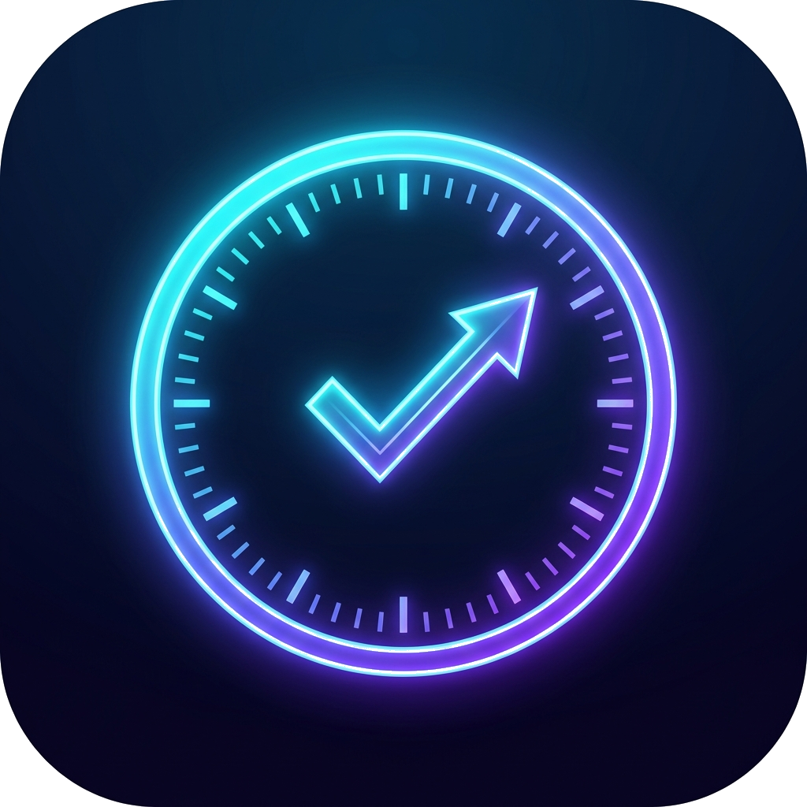

# TRACK IT

<p align="center">
  
</p>

<p align="center">
  <strong>A modern, privacy-first desktop time tracker and productivity suite built natively for Linux (GNOME).</strong><br>
  <em>Integrates seamlessly with GNOME Calendar via Evolution Data Server to bring your schedule, tasks, focus sessions, projects, and habits into one unified workspace.</em>
</p>

<p align="center">
  
  
  
  
  
</p>

---

## 🌟 Overview

**TRACK IT** is a native Linux productivity and time-tracking application designed specifically for the GNOME desktop environment.

It bridges the gap between your system calendar and your daily focus workflow by syncing directly with **GNOME Calendar (Evolution Data Server)**, allowing you to track time against scheduled meetings, plan tasks, log deep work sessions with a dual-mode focus timer, organize projects, and maintain daily habits.

Data is stored in PostgreSQL. Run PostgreSQL locally to retain a fully private, offline setup, or point the app at a managed instance when remote access is required.

---

## ✨ Features

### 📅 Native GNOME Calendar Integration

- **Evolution Data Server (EDS)**: Automatically discovers and synchronizes scheduled events from GNOME Calendar in real time.
- **Auto-Sync File Watcher**: Automatically detects and reflects calendar additions, edits, and deletions without manual refreshes.
- **Bi-Directional Workflow**: Track time directly against your calendar events or create independent manual tasks.

### 📝 Task Management & Rich Task Notes

- **Comprehensive Task Tracking**: Set task names, scheduled start dates, priorities (`High`, `Medium`, `Low`), time estimates, and project associations.
- **Rich Task Notes**: Attach multi-line notes, checklists, links, or instructions to any task.
- **Quick Notes Modal**: View and edit task notes from any view with a single click.
- **Visual Note Badges**: Tasks with notes display an accent badge and hover tooltip preview.
- **Flexible Sorting**: Sort tasks by custom manual drag-and-drop order, scheduled start time, or priority level.

### ⏱️ Focus Timer & Pomodoro Mode

- **Dual Tracking Modes**:
  - **Stopwatch Mode**: Open-ended count-up tracking with active progress and estimate gauge.
  - **Pomodoro Mode**: Structured interval tracking with focus presets (`25m / 5m`, `50m / 10m`, `15m / 3m`) and phase tracking (_Focus Session_, _Short Break_, _Long Break_).
- **HUD Task Notes Card**: Displays the active task's notes directly on the timer screen during work sessions with a quick-edit button.
- **Distraction-Free Fullscreen Mode**: Auto-engaging fullscreen timer view with large tabular digits and escape controls.
- **Visual Countdown Ring**: Smooth SVG progress ring with phase-adaptive color accents.
- **Audio Chime Alerts**: Subtle sound cues when focus phases complete or timers stop.
- **Crash Recovery**: Active timer sessions automatically save if the application closes unexpectedly.

### 📊 Time Logs & Manual Session Entry

- **Session History**: Detailed searchable, filterable log of all completed time entries and focus sessions.
- **Manual Work Logger**: Easily log past work sessions that occurred away from your desk with custom date/time, duration, notes, and project assignment.
- **Inline Editing & Deletion**: Modify durations or remove redundant sessions anytime.

### 📁 Projects & Weekly Targets

- **Color-Coded Projects**: Organize tasks and tracked hours into customizable projects with dedicated color tags.
- **Weekly Target Hours**: Set weekly goal hours for each project and monitor real-time completion progress bars.
- **Unassigned Task Pool**: Easily triage unscheduled tasks and assign them to projects via drag-and-drop or select menus.

### 🎯 Daily Habit Tracker

- **Monthly Check-Off Matrix**: Track daily routines and habits across an interactive monthly grid.
- **Streak Calculation**: Automatically computes consecutive active streaks and completion rates.

### 📈 Productivity Analytics & Heatmap

- **Weekly Distribution**: Dynamic bar charts visualizing daily tracked hours across the current week.
- **Project Breakdown**: Comparative metrics showing where your time was invested.
- **Yearly Contribution Heatmap**: GitHub-style activity grid highlighting your focus intensity throughout the year.
- **Live Streak Badge**: Live streak badge in the sidebar tracking consecutive active days with logged focus time.

### 🔔 Real-Time App Icon & Dock Task Counter

- **Dynamic Task Counter**: Real-time counter of today's pending tasks directly on the application icon, native GNOME/Ubuntu dock, titlebar, and sidebar navigation.
- **Instant Reactive Updates**: Badge count automatically increments when tasks are added, and decrements when tasks are completed, deleted, or rescheduled.
- **Multi-WM Linux Support**: Combines native `setBadgeCount` dock badges with dynamic high-DPI canvas icon overlays and window title updates for seamless visibility across GNOME, KDE, Wayland, and X11.
- **Configurable Preferences**: Customize badge behavior in Settings (_Pending Tasks Today_, _All Tasks Today_, or _Disabled_).

### 🎨 Design & Custom UI

- **Glassmorphism Design System**: Modern translucent backdrops, glowing accents, and smooth transitions.
- **Custom Popover Pickers**: Handcrafted date and time pickers featuring digital clock displays, month navigation, 12-hour/minute selector grids, stepper controls, and quick presets (`Now`, `+15m`, `+30m`, `+1h`).
- **Dark & Light Themes**: Instant theme toggle accessible from the titlebar.

### 🔒 PostgreSQL Storage

- **Reliable concurrency**: Uses a pooled PostgreSQL connection with parameterized queries and transactions.
- **Automatic schema setup**: Tables and indexes are created safely on startup.
- **Backup & Portability**: Export your complete database to JSON, import backups, or perform scoped data resets from **Settings**.

---

## ⌨️ Keyboard Shortcuts

Control your workspace efficiently without leaving the keyboard:

| Shortcut                                                       | Action                    | Description                                                                                                                                         |
| :------------------------------------------------------------- | :------------------------ | :-------------------------------------------------------------------------------------------------------------------------------------------------- |
| <kbd>Ctrl</kbd> + <kbd>N</kbd> / <kbd>Cmd</kbd> + <kbd>N</kbd> | **Quick Add Task**        | Opens the task creation modal from any view                                                                                                         |
| <kbd>Spacebar</kbd>                                            | **Toggle Timer**          | Starts, pauses, or resumes the active focus timer                                                                                                   |
| <kbd>Ctrl</kbd> + <kbd>1</kbd> .. <kbd>9</kbd>                 | **Dynamic View Switcher** | Dynamically jumps to the $N^{\text{th}}$ sidebar tab (Dashboard, Schedule, Calendar, Focus Timer, Time Logs, Projects, Habits, Analytics, Settings) |
| <kbd>Esc</kbd>                                                 | **Dismiss / Exit**        | Closes active modals, date/time popovers, or exits fullscreen timer mode                                                                            |

---

## 🛠️ Tech Stack & Architecture

- **Runtime**: [Electron 44](https://www.electronjs.org/)
- **Database**: [PostgreSQL](https://www.postgresql.org/) via [`pg`](https://node-postgres.com/)
- **Calendar Parsing**: [`node-ical`](https://github.com/jens-maus/node-ical) + GNOME Evolution Data Server (`~/.local/share/evolution/calendar`)
- **Frontend**: Vanilla ES Modules, Semantic HTML5, and CSS Design System (Zero Heavy Frameworks)

---

## 🚀 Getting Started

### Prerequisites

- **Linux OS** with **GNOME Desktop Environment** (for GNOME Calendar integration)
- **Node.js** `>= v20.0.0` (v24 LTS recommended)
- **npm** `>= v10.0.0`
- **PostgreSQL** `>= 14`

### Installation

1. **Clone the repository:**

   ```bash
   git clone https://github.com/abdullahsamir74/TRACK-IT.git
   cd TRACK-IT
   ```

2. **Install dependencies:**

   ```bash
   npm install
   ```

3. **Create a database and configure the connection:**

   ```bash
   sudo -u postgres createuser --pwprompt trackit
   sudo -u postgres createdb --owner=trackit trackit
   cp .env.example .env
   # Edit .env and replace YOUR_PASSWORD with the password for the trackit role.
   ```

   The application reads `.env` automatically, including when launched from GNOME. Set `PGSSL=true` in that file as well when your PostgreSQL provider requires TLS.

4. **Launch the application:**

   ```bash
   npm start
   ```

5. **Launch in development mode (with DevTools):**
   ```bash
   npm run dev
   ```

### Migrating existing SQLite data

Before launching the new version, migrate the previous local database once. This requires the `sqlite3` command-line utility and leaves the original file untouched:

```bash
npm run migrate:sqlite
```

Pass a SQLite file path as the final argument if it is not at the old default location: `npm run migrate:sqlite -- /path/to/tracker.sqlite`.

---

## 🖥️ Desktop Integration (GNOME Dock / App Launcher)

To register **TRACK IT** with your system application launcher and pin it to your GNOME Dock:

1. Run the desktop installer script:
   ```bash
   npm run install-desktop
   ```
2. Press <kbd>Super</kbd> (Windows key), search for **TRACK IT**, right-click the application icon, and click **Add to Favorites** / **Pin to Dash**.

---

## 🗄️ Database Inspection

The connection is supplied by your untracked `.env` file; the application never stores credentials in the repository. To use the following commands, load it into your shell first: `set -a; source .env; set +a`.

```bash
psql "$DATABASE_URL" -c 'SELECT id, name, notes, status, priority FROM tasks;'
psql "$DATABASE_URL" -c 'SELECT task_name, duration_minutes, start_time FROM time_entries ORDER BY start_time DESC LIMIT 10;'
```

---

## 📄 License

Distributed under the **MIT License**. See [`LICENSE`](LICENSE) for details.
